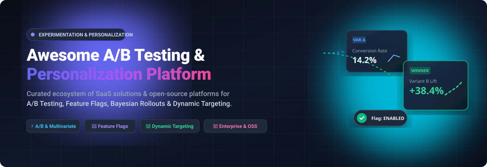

# 🚀 Awesome A/B Testing & Personalization Platform 🎯

**The definitive community-curated index of A/B testing platforms, multivariate experimentation engines, dynamic personalization systems, feature flag toggles, and self-hosted open-source experimentation frameworks.**

*Empowering product managers, growth engineers, data scientists, and DevOps teams to make evidence-backed decisions, eliminate regression risk, and deliver personalized user journeys.*

📅 **Last updated: October 2026**

---

## 📖 Table of Contents

- [✨ Overview & Key Capabilities](#-overview--key-capabilities)
- [🏢 SaaS / Hosted Enterprise Platforms](#-saas--hosted-enterprise-platforms)
  - [📊 Sector Overview & Market Dynamics](#-sector-overview--market-dynamics)
  - [🏷️ SaaS Platforms Comparison](#️-saas-platforms-comparison)
- [💻 Open-Source GitHub Projects](#-open-source-github-projects)
- [⭐ Star History](#-star-history)
- [🤝 How to Contribute](#-how-to-contribute)
- [💖 Support & Sponsor](#-support--sponsor)
- [⚖️ Disclaimer](#️-disclaimer)

---

## ✨ Overview & Key Capabilities

Digital experience optimization and conversion rate optimization (CRO) have evolved far beyond basic button-color tests. Modern **A/B testing, multivariate experimentation, and personalization stacks** integrate directly with modern data warehouses (Snowflake, BigQuery, Databricks, Redshift), client/server-side feature management pipelines, and machine-learning recommendation algorithms.

### 🔍 Core Architectural Pillars:
* **🧪 Statistical Rigor**: Bayesian vs. Frequentist sequential testing engines that control False Discovery Rates (FDR), tolerate continuous data peeking, and run multi-armed bandit (MAB) dynamic traffic allocations.
* **🚩 Feature Flags & Progressive Delivery**: Decouple deployment from release with canary releases, ring deployments, percentage rollouts, and instant automated rollbacks on anomalous latency or error metrics.
* **🎯 Dynamic Personalization**: Tailor real-time frontend and server-side experiences based on customer data platform (CDP) traits, geolocation, behavioral heuristics, and predictive propensity models.
* **💾 Warehouse-Native Experimentation**: Run zero-copy SQL queries directly inside your company data warehouse, guaranteeing 100% data ownership, compliance with privacy regulations (GDPR/CCPA), and zero per-event vendor tax.

---

## 🏢 SaaS / Hosted Enterprise Platforms

### 📊 Sector Overview & Market Dynamics

The global A/B testing and digital experimentation software market is estimated between **$1.5B to $2.5B+** (expanding beyond **$8B+** when including broader AI personalization and customer experience optimization suites), growing at a compound annual growth rate (CAGR) of ~12% to 15%. The sector is **moderately fragmented**: enterprise digital experience suites (Adobe, Optimizely) command large enterprise accounts alongside major feature management vendors, but the market is not winner-take-all—specialized CRO/visual testing platforms (VWO/AB Tasty) and agile modern warehouse-native platforms (Statsig, Eppo) hold strong, defensible positions across developers and data teams.

### 🏷️ SaaS Platforms Comparison

| Product | Description | Company Size / Valuation / Revenue | Pricing | Free Tier Limit |
| :--- | :--- | :--- | :--- | :--- |
| **[Adobe Target](https://business.adobe.com/products/target/adobe-target.html)** | Enterprise personalization and experimentation within Adobe Experience Cloud. | **Market Cap: ~$105B+**; Adobe annual revenue **$21B+** | Starts at **~$40,000–$80,000/year** (annual contract required; metered by annual server calls/impressions). | **No free tier**; no public trial (enterprise sales-guided POC sandbox only). |
| **[LaunchDarkly](https://launchdarkly.com/)** | Feature management and experimentation platform with enterprise audit trails and progressive delivery. | **Valuation: ~$3B** (Series D); ARR **~$100M+** | Paid Foundation tier starts at **$12/user/month** (metered by context MAUs and service connections; experimentation add-on scales based on monthly evaluated keys). | **Perpetual Free Plan (Developer)**: Unlimited seats and feature flags across 1 project & 3 environments; strictly capped at **1,000 context MAUs/month** and 5 service connections. |
| **[Optimizely](https://www.optimizely.com/)** | Enterprise experimentation, CMS, and feature flagging platform with marketer visual editor. | **Valuation: ~$1.5B–$2B** (PE-backed by Insight Partners); ARR **$400M+** | Starts at **~$36,000–$50,000/year** (custom annual/2-year enterprise commitment; scales to $150K+/year by traffic volume). | **No free tier** (eliminated in 2015); no self-serve free trial (guided sales POC sandboxes only). |
| **[Statsig](https://www.statsig.com/)** | Cloud and warehouse-native experimentation platform with sequential testing and product analytics. | **Valuation: ~$1.1B** (Series C unicorn); ARR **~$40M+** | Free tier available; paid Pro tier starts at **$150/month** (includes 5M events, additional events at $0.05/1K events). | **Perpetual Free Plan (Developer)**: **2,000,000 metered events/month**, 50,000 session replays/month, unlimited seats, and unlimited flag checks. |
| **[VWO / AB Tasty (Wingify)](https://vwo.com/)** | Merged entity combining VWO and AB Tasty; A/B testing and personalization with visual editor. | **Valuation: ~$200M** (Everstone Capital buyout); Wingify revenue **~$50M/year** | Starter/Growth plans start at **~$200–$314/month** billed annually (scales up by Monthly Tracked Users starting from 10,000–50,000 MTUs). | **No permanent free tier**; provides a **30-day full-featured free trial** across testing, heatmaps, and personalization modules. |
| **[Eppo](https://www.geteppo.com/)** | Warehouse-native experimentation platform focused on rigor and statistical correctness. | **Valuation: ~$138M** (Series B post-money); Total funding **$51.3M** | Custom quote-based entry tiers typically start at **$15,000–$20,000/year** for small teams (5–10 seats), scaling to $40K–$120K/year for larger seat counts. | **No permanent free tier**; no public self-service trial (evaluation via sales-guided pilot / data warehouse POC). |

---

## 💻 Open-Source GitHub Projects

*Open-source platforms sorted in descending order of GitHub stargazers.*

- **[PostHog](https://github.com/PostHog/posthog)**  🌟  
  **The all-in-one open-source product analytics, feature flagging, and experimentation suite.** Default for engineering-led teams in 2026. Experiments are bundled natively with feature flags and session replays with identical billing. Includes multi-variate variants, secondary metrics, sample size calculators, and automated statistical significance detection.  
  * **Free Cloud Allowance**: 1,000,000 events/month, 1,000,000 feature flag evaluations/month, and 5,000 session replays.

- **[Unleash](https://github.com/Unleash/unleash)**  🌟  
  **The enterprise-grade open-source feature management standard.** Built in Node.js and TypeScript, Unleash supports gradual rollouts, canary deployments, targeted user segments, and experiment metric evaluations across mobile, web, and backend SDKs.  
  * **Open-Source Edition**: 100% free and self-hostable with no seat limits; includes core feature flagging with caps of 1 project, 2 environments, and 5,000 flags per instance.

- **[GrowthBook](https://github.com/growthbook/growthbook)**  🌟  
  **The leading open-source, warehouse-native experimentation and feature flag platform.** Connects directly to BigQuery, Snowflake, Databricks, Redshift, ClickHouse, and Postgres. Supports Bayesian and Frequentist statistics with automated CUPED variance reduction, peer review workflows, and visual A/B editor extensions.  
  * **Deployment**: Unlimited self-hosted community version with full statistical engine and feature flag capabilities.

- **[Flagsmith](https://github.com/Flagsmith/flagsmith)**  🌟  
  **Open-source feature flag, remote config, and multivariate experimentation platform.** Enables complete release control across web, mobile, and server environments. Flagsmith allows developers to toggle features, run A/B multivariate tests, and dynamically update configuration values without redeploying code.  
  * **Deployment**: Fully dockerized open-source engine; Cloud free tier with 50,000 requests/month.

- **[Flipt](https://github.com/flipt-io/flipt)**  🌟  
  **High-performance, cloud-native feature management and experimentation platform written in Go.** Designed with a GitOps-first mentality and zero external dependencies. Supports both declarative configuration (YAML/JSON checked into Git) and REST/gRPC/OpenFeature APIs with local caching and sub-millisecond evaluation latency.  
  * **Highlights**: Native OpenFeature provider support, distributed architecture, and multi-tenant segmentation.

- **[Flipper](https://github.com/flippercloud/flipper)**  🌟  
  **The de-facto open-source feature toggle and experimentation suite for Ruby and Rails.** Backed by versatile adapters (Redis, ActiveRecord, Memcached, Mongo, Consul), Flipper allows toggling features by percentage of actors, percentage of time, groups, or individual user IDs.  
  * **Highlights**: Extremely fast in-memory execution, web admin UI dashboard, and battle-tested in high-throughput production environments.

- **[GO Feature Flag](https://github.com/thomaspoignant/go-feature-flag)**  🌟  
  **A lightweight, zero-infrastructure feature flagging and experimentation solution.** Read flag rules directly from S3, GitHub, HTTP, Kubernetes ConfigMaps, or local files. Evaluates progressive rollouts, A/B experiments, and user segmentation without maintaining complex database clusters.  
  * **Highlights**: Native OpenFeature compliance, zero-dependency Go core, and support for 15+ SDK language bindings via a standalone relay proxy.

- **[FeatBit](https://github.com/featbit/featbit)**  🌟  
  **100% open-source, fast, and scalable feature flags and experimentation platform.** Written in .NET and Vue, FeatBit offers real-time data streaming, granular targeting rules, multivariate tests, and customized workflow approvals. Built as an open alternative to LaunchDarkly for high-concurrency microservices.  
  * **Deployment**: AGPL-3.0 licensed; docker-compose setup with free self-hosting.

- **[FeatureProbe](https://github.com/FeatureProbe/FeatureProbe)**  🌟  
  **Open-source feature management and progressive rollout service.** Focuses on decoupling code deployment from feature release, canary testing, and multivariate A/B testing with high-throughput Rust evaluation engines.  
  * **Highlights**: Real-time WebSocket toggle updates, client and server-side SDKs, and statistical performance metrics.

- **[Wasabi](https://github.com/intuit/wasabi)**  🌟  
  **Real-time, enterprise-grade, 100% API-driven A/B testing and experimentation service developed by Intuit.** Built in Java/Cassandra for high-volume enterprise traffic, allowing teams to run concurrent bucket tests across web, mobile, and desktop applications with strict data isolation.  
  * **Highlights**: Apache-2.0 licensed, proven at enterprise scale, and zero third-party data tracking.

- **[flagd (OpenFeature)](https://github.com/open-feature/flagd)**  🌟  
  **A CNCF (Cloud Native Computing Foundation) feature flag evaluation daemon.** Follows the Unix philosophy: a lightweight daemon that evaluates feature flags locally, receiving flag definitions from Git, Kubernetes CRDs, HTTP endpoints, or cloud storage.  
  * **Highlights**: Vendor-agnostic OpenFeature standard, ultra-low latency, and native Kubernetes controller integration.

- **[dif.sh](https://github.com/dif-sh/dif)**  🌟  
  **The Git-native experimentation and A/B testing tool.** Treats experiments and feature toggles as version-controlled Markdown files stored directly alongside your application source code. PR reviews govern rollout decisions, keeping statistical rationale and experiment post-mortems in Git history.  
  * **Highlights**: Zero external SaaS reliance, full offline reviewability, and built-in developer ergonomics.

- **[Replane](https://github.com/replane-dev/replane)**  🌟  
  **Open-source, self-hosted feature flags and dynamic configuration engine.** Features sub-second configuration propagation to distributed clients via Server-Sent Events (SSE). Enables instant toggle changes without redeployment.

---

## 📈 Star History

---

## 🤝 How to Contribute

Contributions make the open-source community an amazing place to learn, inspire, and create! Any contributions you make are **greatly appreciated**.

1. 🍴 **Fork the Project**
2. 🌿 **Create your Feature Branch** (`git checkout -b feature/AddAwesomeTool`)
3. 💾 **Commit your Changes** (`git commit -m 'Add awesome experimentation tool'`)
4. 🚀 **Push to the Branch** (`git push origin feature/AddAwesomeTool`)
5. 📬 **Open a Pull Request**

*Please ensure your submission links to official project repositories or homepages and follows the existing markdown schema.*

---

## 💖 Support & Sponsor

If you find this curated ecosystem helpful in choosing or deploying your experimentation platform, please consider showing your support:

* ⭐ **Star this repository** to improve visibility for other engineers!
* 🍴 **Fork the repo** to keep a reference in your profile!
* 📢 **Share with your colleagues** on LinkedIn, Twitter/X, and tech communities!
* ☕ **Buy me a coffee**: Support ongoing curation and open-source contributions via the **[GitHub Sponsors Dashboard](https://github.com/sponsors/ishandutta2007)**!

---

## ⚖️ Disclaimer

- This curated list is maintained for informational and educational purposes. Inclusion does not imply official commercial endorsement.
- Enterprise SaaS pricing and minimum commitments change frequently: Optimizely maintains multi-year enterprise contracts, while cloud feature flag platforms meter by context MAUs. Always verify current tiers with vendors before signing MSAs.
- Open-source editions often differentiate between community releases and enterprise governance (SSO, audit logs, automated compliance). Benchmark and review license files before deploying in regulated production environments.

---

  Maintained with ❤️ by <a href="https://github.com/ishandutta2007">Ishan Dutta</a> and the open-source experimentation community.

